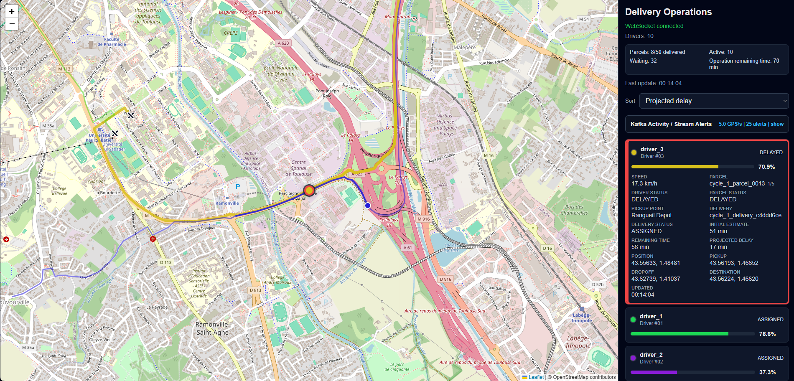
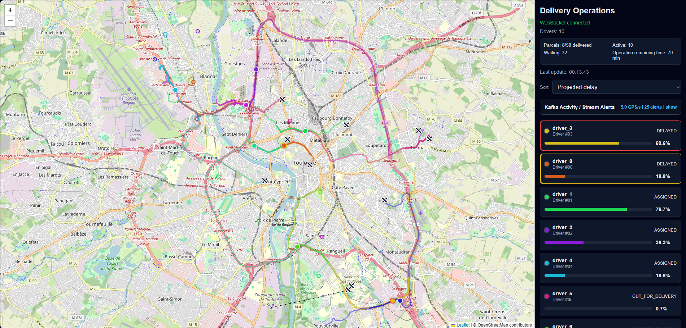
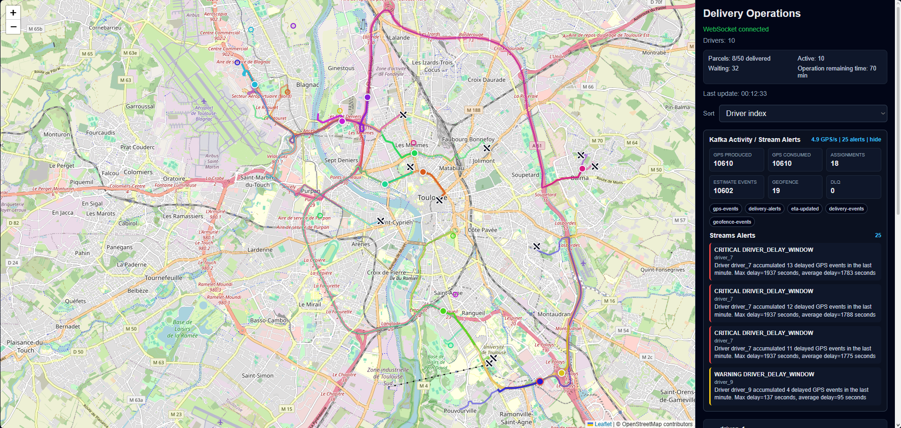
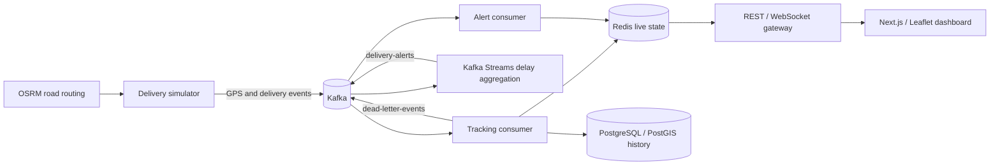

# Kafka Real-Time Delivery Operations Platform

A backend portfolio project built around Kafka: **10 drivers deliver 50 parcels across Toulouse**, while an event pipeline updates their positions, delivery progress and projected delays in real time.

The dashboard makes the backend observable: follow road-based routes, inspect individual deliveries, and watch Kafka activity and Kafka Streams delay alerts.

## Run The Demo

With Docker running, clone the repository and run:

```bash
git clone https://github.com/ZenkoLespadon/kafka-delivery-operations-platform.git
cd kafka-delivery-operations-platform
docker compose up -d
```

Open **http://localhost:3000** once startup completes. Kafka UI is available at http://localhost:8081.

No local Java, Node.js or manual routing setup is required. The first launch downloads dependencies and OSRM road data, then prepares the routing network; **allow several minutes**. Later launches reuse the data. Internet access and free host ports are required; see [setup and troubleshooting](docs/technical-guide.md#run-the-full-demo).

## See It In Action

### Live Map And Kafka Monitoring



Drivers follow OSRM road routes. The monitoring panel shows event activity and delay alerts generated by Kafka Streams.

<details>
<summary>Driver ranking and delivery details</summary>

### Driver Ranking



Sort drivers by projected delay, progress, speed or status. Yellow outlines indicate positive delays up to five minutes; red indicates delays over five minutes.

### Driver Details



Select a driver to focus the map and expand its parcel, pickup, delivery status, initial estimate, remaining time and projected delay. Select it again to collapse the card.

</details>

## Architecture



The simulator, consumers, stream topology and API run in **one Spring Boot application**, with separate internal responsibilities. This keeps the local demo manageable while making the event flow explicit.

**Stack:** Java 21, Spring Boot, Spring Kafka, Kafka Streams, PostgreSQL/PostGIS, Redis, TypeScript, Next.js, React, Leaflet, WebSocket, OSRM, Docker Compose, JUnit and Testcontainers.

## What The Backend Demonstrates

| Engineering concern | Implementation |
| --- | --- |
| Event-driven processing | GPS records keyed by driver ID flow through Kafka into independent tracking and stream-processing consumers. |
| Stream aggregation | Event-time, one-minute windows with a 30-second grace period aggregate delayed GPS records by driver. |
| Invalid and duplicate events | The tracking consumer routes rejected GPS events to a DLQ and checks event IDs in Redis with a 24-hour expiry. |
| Out-of-order telemetry | Records within a 30-second tolerance are stored in history without moving live state backwards; older records go to the DLQ. |
| Storage boundaries | Redis serves the live projection; PostgreSQL/PostGIS persists geographical position history. |
| Reproducible startup | Compose downloads/prepares OSRM once, retries interrupted downloads and waits for service readiness. |
| Automated verification | Testcontainers checks Kafka production/consumption and PostgreSQL/Redis projection; topology tests exercise delay alerts. |

The stream topology emits a warning after three delayed GPS records in a window, or a critical alert when the maximum delay reaches five minutes. It updates alerts as the window aggregate changes.

**Code to explore:** [tracking and event handling](backend/src/main/java/com/github/zenkolespadon/delivery/tracking/GpsTrackingService.java), [Kafka Streams topology](backend/src/main/java/com/github/zenkolespadon/delivery/streams/DelayAlertTopology.java), [integration tests](backend/src/test/java/com/github/zenkolespadon/delivery/DeliveryBackendIntegrationTest.java).

## Try The Event Pipeline

1. Watch drivers move and select one to inspect its delivery.
2. Sort by projected delay and observe the yellow/red delay indicators.
3. Expand Kafka Activity / Stream Alerts and compare produced/consumed GPS counters.
4. Open Kafka UI to inspect `gps-events`, `delivery-events`, `eta-updated`, `geofence-events`, `delivery-alerts` and `dead-letter-events`.

Each driver receives five parcels and stops when finished. A new cycle starts once all ten drivers have completed their deliveries.

## Tests And Verification

With Java 21, Maven and Docker available:

```bash
cd backend
mvn test
```

The suite includes Testcontainers integration tests, Kafka Streams topology tests, and unit tests for routing recovery, delay statistics, activity counters and alert storage. Docker image builds skip test execution.

Check a running demo with `docker compose ps -a` and http://localhost:8080/actuator/health. See the [technical guide](docs/technical-guide.md) for containerized test commands, API checks, event examples and troubleshooting.

## Scope And Tradeoffs

This is a local event-processing demo. Dispatch uses a fixed allocation per cycle; it does not solve route optimization. Replay and Grafana dashboards remain future work; an Actuator Prometheus endpoint is available.

Redis writes, database transactions and Kafka offset commits are not atomic together, so the system does not guarantee end-to-end exactly-once processing. Kafka Streams reads raw GPS records independently of tracking validation/deduplication. Kafka also has no explicitly configured persistent volume in this demo.

## Stop Or Update

```bash
docker compose down                 # Stop and retain database / Redis / OSRM volumes
docker compose up -d --build         # Rebuild after source changes
```

`docker compose down -v` also deletes stored data, including the prepared road network.

Repository: [backend](backend/) | [frontend](frontend/) | [OSRM setup](infra/osrm/) | [Technical guide](docs/technical-guide.md)
